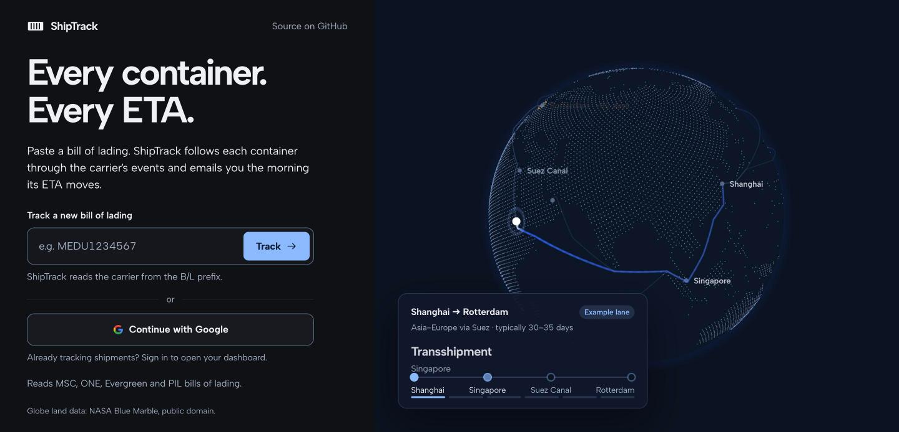
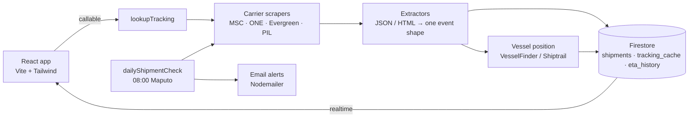

# ShipTrack

Paste a bill of lading. ShipTrack follows every container through the carrier's events, shows the voyage on a globe, and emails you the morning its ETA moves.

**Live:** [shipmenttrack-837ec.web.app](https://shipmenttrack-837ec.web.app) · **Carriers:** MSC, ONE, Evergreen, PIL



## What it does

- **Tracks any B/L.** The carrier is detected from the B/L prefix. No carrier login is needed.
- **One timeline, four carriers.** Each carrier's JSON or HTML is normalized into the same event shape.
- **Shows the voyage.** A Three.js globe draws the route port by port and places the vessel. The position comes from live AIS data when available, otherwise it is estimated from the latest event.
- **Watches ETAs.** A daily job re-checks every shipment, records each ETA change, and emails the owner.
- **Cleans up after itself.** A shipment is archived automatically once every container has been returned empty.

## Architecture



- **Frontend:** React 19 SPA on Firebase Hosting. It reads Firestore in real time and never writes tracking data.
- **Backend:** Firebase Cloud Functions (Node 22, 2nd gen): one callable, one scheduled job, one HTTP trigger.
- **Data:** Firestore. The security rules make tracking fields server-owned, so a user can edit their ETA but never carrier events.

## Engineering highlights

**Four carriers, one data model.** Each carrier gets an adapter in [`trackingExtractors.js`](functions/lib/trackingExtractors.js) that returns `{ eta, events[] }`. Every event has the same fields: title, location, container, time, vessel, voyage and IMO. The UI never knows which carrier it is showing.

| Carrier | Source | What made it tricky |
|---|---|---|
| MSC | JSON API | Mixes actual and planned moves. Planned rows are detected by title or by a future date. |
| ONE | JSON API | Events are codes (`E061`, `E089`). Mapped from ONE's own UI; `E105` is a demurrage deadline, not an arrival. |
| Evergreen | HTML | The B/L page has statuses only. Full moves come from one extra request per container, built from a hidden form. |
| PIL | JSON wrapping HTML | Trace rows are bare `<tr>` elements that an HTML parser drops unless they are wrapped in a `<table>`. |

**ETA change detection.** The daily check compares each carrier ETA with the stored one. A change writes an `eta_history` entry and goes out in that morning's email, along with reminders for boxes arriving within the user's alert window. Carrier results are cached for 24 hours.

**Live vessel position.** [`vesselPosition.js`](functions/lib/vesselPosition.js) works out which vessel the box is on (only after a load or departure). It then looks up the latest AIS fix:
- by IMO on VesselFinder, when an API key is set;
- otherwise by name on Shiptrail (free).

It only accepts exact name matches, an IMO that agrees, and fixes newer than the departure. Look-alike vessel names return nothing rather than a wrong dot.

**Voyage globe.** [`voyageRoute.js`](src/lib/voyageRoute.js) turns carrier location strings ("MAPUTO, MZ", "SINGAPORE CMA CGM PSA LION TERMINAL", "MZMPM") into ports, in visit order. It places the vessel part-way along the current leg by time, and frames the camera on the two ports farthest apart. Rendering is [Three.js](src/components/VoyageGlobe.jsx) with a shader-driven route, and there is a static fallback for reduced motion or no WebGL.

**Security.** [`firestore.rules`](firestore.rules) scope every document to its owner. Fields such as `latestEvent`, `trackingStatus` and `vesselPosition` are writable only by Cloud Functions.

**Tested where it breaks.** The extractors are tested against fixtures shaped like real carrier responses. The route, arrival and vessel-matching logic has its own unit tests (38 tests, `node --test`).

## Tech stack

| Layer | Tools |
|---|---|
| Frontend | React 19, Vite, Tailwind CSS v4, Three.js, GSAP |
| Backend | Firebase Cloud Functions (Node 22), Axios, Cheerio, Nodemailer |
| Data | Firestore with security rules |
| Delivery | Firebase Hosting, GitHub Actions (preview per PR, deploy on merge) |

## Project structure

```text
functions/
  index.js                  callable, scheduled job, scrapers, emails
  lib/trackingExtractors.js carrier adapters → one event shape
  lib/vesselPosition.js     AIS lookup (VesselFinder / Shiptrail)
src/
  pages/                    Dashboard, ShipmentDetail, Archive, Profile, Login
  components/               VoyageGlobe, EtaLane (arrivals strip)
  lib/                      pure logic: routes, ports, ETA buckets
test/                       node:test unit tests
firestore.rules             per-user access, server-owned fields
```

## Run it locally

```bash
npm install
cp .env.example .env   # fill in your Firebase web app config
npm run dev
```

Functions use their own folder (`cd functions && npm install`). Email alerts need the `SMTP_EMAIL` and `SMTP_PASSWORD` secrets. Live AIS through VesselFinder is optional and needs `VESSELFINDER_API_KEY`.

```bash
node --test test/*.test.js                               # unit tests
npx firebase deploy --only functions,firestore:rules     # backend
```

The frontend deploys automatically when a PR is merged to `main`.

## Next

- More carriers (Maersk, CMA CGM, Hapag-Lloyd)
- Carrier ETA accuracy over time, from `eta_history`
- Sea-route paths on the globe instead of port-to-port arcs

## Note

An independent project. Carrier websites and their response formats can change without notice. Vessel positions are not for navigation.
